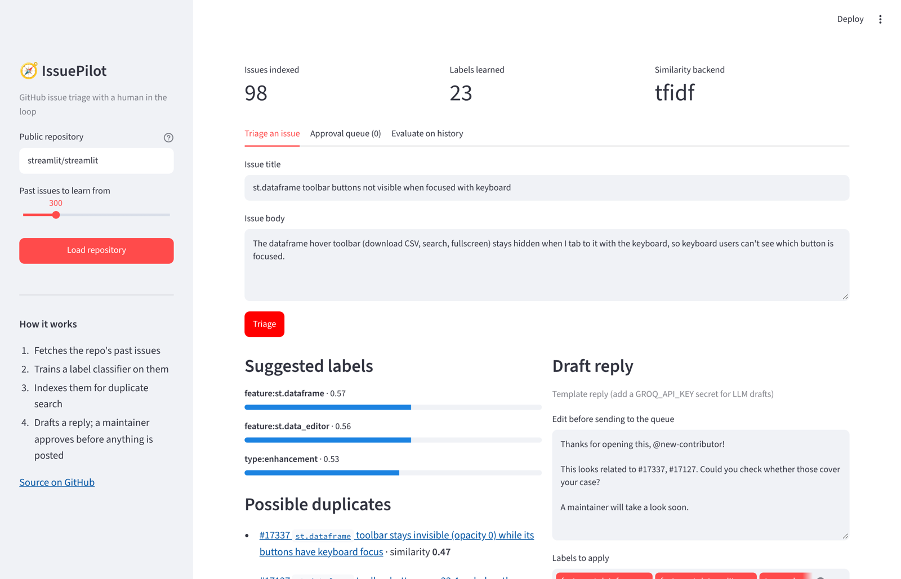
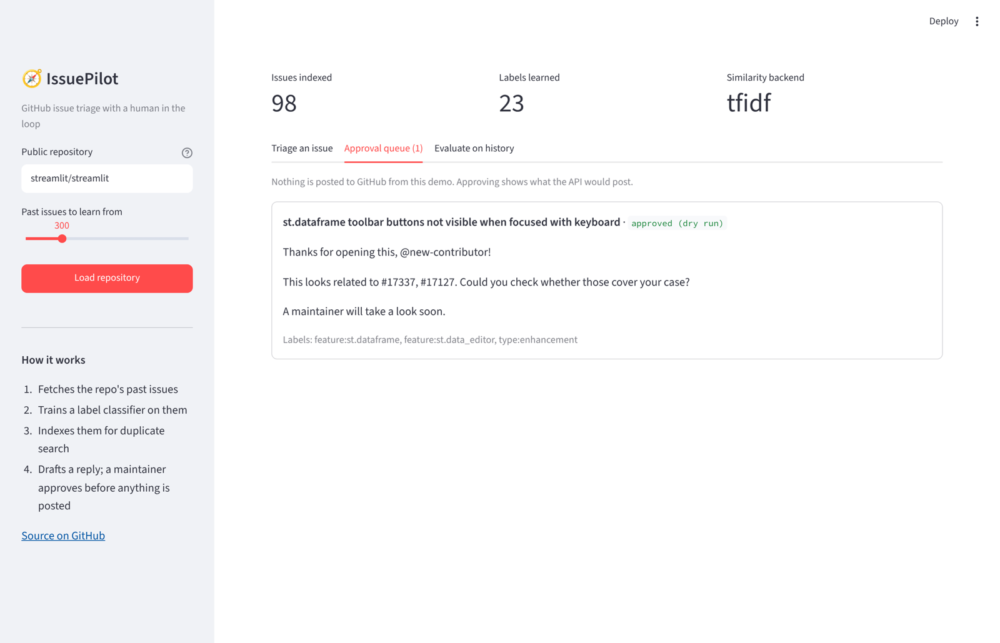
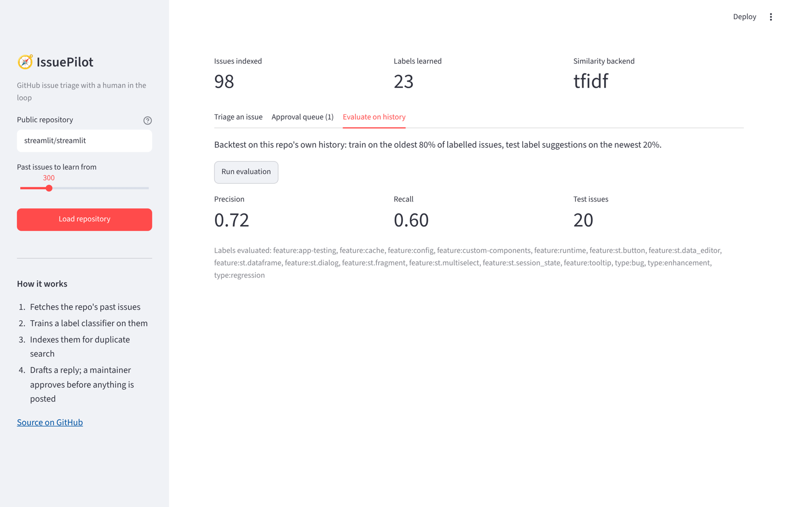

# IssuePilot — GitHub Issue Triage Assistant

IssuePilot watches a repository for new issues and prepares a triage for a maintainer:

- **Suggested labels**, learned from the repository's own labelled history (TF-IDF + one-vs-rest logistic regression)
- **Likely duplicates**, ranked by semantic similarity to past issues (sentence-transformers embeddings, TF-IDF fallback)
- **A draft first reply**, written by an LLM (Groq) or a template when no API key is set

**Nothing is posted automatically.** Every triage is stored as *pending*. A maintainer approves it, optionally editing the reply or labels, and only then does IssuePilot comment on GitHub.

```
GitHub "issue opened" webhook ──▶ verify HMAC signature
                                     │
                     ┌───────────────┼────────────────┐
                     ▼               ▼                ▼
              label classifier   similarity index   reply drafter
                     └───────────────┼────────────────┘
                                     ▼
                           SQLite: status = pending
                                     │  maintainer: approve / edit / reject
                                     ▼
                     GitHub API: post comment + apply labels
```

## Demo UI

`streamlit_app.py` is a web interface: enter any public repo, and it learns that repo's labels, then triages an issue you type. It shows suggested labels with confidence, linked possible duplicates and an editable draft reply. There's also an approval queue (a dry run that never posts to GitHub) and a backtest of label accuracy on the repo's own history.

**Live demo:** _link added after deployment_



| Approval queue (dry run) | Backtest on the repo's own history |
|---|---|
|  |  |

*Screenshots run on 98 recent `streamlit/streamlit` issues. Backtest (train on the oldest 80%, test on the newest 20%, issue titles only): label **precision 0.72, recall 0.60** across 16 labels.*

```bash
pip install -r requirements.txt
streamlit run streamlit_app.py
```

Deploy free on [Streamlit Community Cloud](https://share.streamlit.io): New app → this repo → main file `streamlit_app.py`. Optional secrets: `GITHUB_TOKEN` (higher GitHub rate limit), `GROQ_API_KEY` (LLM-written drafts) and `LLM_MODEL` (Groq model, e.g. `openai/gpt-oss-120b`).

## Quick start (API)

```bash
pip install -r requirements.txt
pip install -r requirements-embeddings.txt   # optional: embedding-based duplicate search
cp .env.example .env

# 1. Learn from a repo's history (any public repo works)
python scripts/index_repo.py fastapi/fastapi --max 500 --out data/issues.json

# 2. Measure how well it does on that history
python scripts/evaluate.py --issues data/issues.json

# 3. Run the API
uvicorn app.main:app --reload
```

Try a triage preview (stores and posts nothing):

```bash
curl -X POST localhost:8000/triage -H "Content-Type: application/json" \
  -d '{"title": "App crashes on startup", "body": "KeyError when loading config"}'
```

## API

| Method | Path | What it does |
|---|---|---|
| GET | `/health` | Index size, similarity backend, labels learned, dry-run status |
| POST | `/triage` | Preview a triage for any issue text |
| POST | `/webhook/github` | GitHub webhook receiver; stores a pending triage for new issues |
| GET | `/pending` | Triage results waiting for approval |
| POST | `/pending/{id}/approve` | Approve; optional body `{"reply": "...", "labels": [...]}` to edit first |
| POST | `/pending/{id}/reject` | Discard |

## Connecting a repository

1. Repo **Settings → Webhooks → Add webhook**: payload URL `https://<host>/webhook/github`, content type `application/json`, a secret (put it in `WEBHOOK_SECRET`), event **Issues**.
2. Set `GITHUB_TOKEN` (fine-grained, *Issues: read & write*) and `DRY_RUN=false` to allow posting after approval.
3. For local testing, expose the port with a tunnel such as ngrok.

## Design notes

- **Why learn labels per repo?** Every project uses its own label set; a classifier trained on the repo's history adapts to it. Labels with fewer than 3 past examples are skipped.
- **Why two similarity backends?** Embeddings handle paraphrases ("crashes on launch" ≈ "fails at startup"). TF-IDF needs no model download and keeps tests fast and deterministic.
- **Human in the loop:** a wrong comment from a bot on someone's first issue is costly, so the system drafts and a person decides.
- **Signature check:** webhook payloads are verified with HMAC-SHA256 (`X-Hub-Signature-256`) using a constant-time comparison.

## Tests

```bash
pytest -q
```

Covers duplicate retrieval, label suggestion, signature verification and the full webhook → pending → approve flow.

## Next steps

- A small review UI for pending items
- Index newly approved issues so duplicates stay current
- Track approval vs edit rate as a live quality signal
